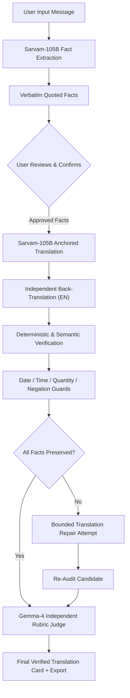

# Telephone Lab ↝
### *Change the language. Keep the meaning.*

[-0d9488?style=for-the-badge)](https://sarvam.ai)
[](https://api.sarvam.ai)
[](https://api.sarvam.ai)
[](#supported-languages)
[](#test-suite--quality-assurance)

**Telephone Lab** is an inspectable message preservation studio and research platform designed for Indian languages. It ensures that when life-critical messages, emergency advisories, civic notices, or health instructions travel across languages, their crucial facts—deadlines, quantities, helpline numbers, and safety constraints—arrive intact.

---

## 📽️ Demo Video & Walkthrough

A complete Full HD (1080p, 60fps) live walkthrough of Telephone Lab is available:
- **Watch/Download**: [telephone_lab_demo_viksit_garg.mp4](public/lab/telephone_lab_demo_viksit_garg.mp4)
- **Local Stream**: [http://127.0.0.1:8787/lab/telephone_lab_demo_viksit_garg.mp4](http://127.0.0.1:8787/lab/telephone_lab_demo_viksit_garg.mp4)
- **Presenter**: **Viksit Garg** (Culture Coded Track)

---

## The Problem: The "Telephone Drift"

Standard machine translation engines optimize for **surface fluency**, not **factual preservation**. When an emergency drill or alert is translated across languages:
- **Deadlines shift**: *"by 6 PM"* subtly morphs into *"before 6 PM"* or *"at 6 PM"*.
- **Quantities blur**: *"2 bottles of water per person"* becomes *"2 bottles of water"* (dropping the critical qualifier).
- **Negations vanish**: *"Do not use the bridge"* gets inverted or weakened into *"Use the bridge carefully"*.
- **Numbers distort**: Helpline phone numbers and numeric dates suffer script transliteration errors.

In disaster response or health communications across India's linguistic diversity, dropped or altered facts are unacceptable. **Telephone Lab fixes this by anchoring translations to inspectable, user-confirmed facts.**

---

## ✨ Key Features & Capabilities

### 1. Grounded Atomic Fact Extraction (Sarvam-105B)
- Automatically decomposes any input text into atomic, checkable claims (actions, locations, deadlines, phone numbers, quantities, negations, and conditions).
- **100% Grounded in Verbatim Evidence**: Every extracted fact is strictly bound to an exact source quotation in the original script.

### 2. Human-in-the-Loop Fact Approval
- The user reviews, edits, removes, or adds critical details before translation begins.
- Marking facts as **Critical** establishes a strict non-negotiable verification anchor.
- Editing source text automatically invalidates stale fact sets to maintain mathematical provenance.

### 3. Multi-Stage Deterministic Verification Pipeline
1. **Anchored Translation**: Sarvam-105B translates the source message with explicit guidance from the approved facts.
2. **Independent Back-Translation**: A separate prompt translates the native-script output back into English without seeing the original facts or source text.
3. **Preservation Audit**: Every approved fact is checked against the back-translation evidence.
4. **Deterministic Normalization Guards**: Deterministic comparisons for 24-hour clocks, fractional Hindi time words (*derh*, *dhai*, *sadhe*), absolute dates, phone numbers across scripts, and Indian number groupings (*lakhs*, *crores*) override LLM confidence.

### 4. Automated Bounded Repair
- If a fact is altered or an ungrounded claim is invented, the studio automatically triggers a **targeted repair attempt** with the failure diagnostics.
- Both candidates are evaluated, and the superior candidate is retained while keeping any remaining nuances visibly flagged as `NEEDS REVIEW`.

### 5. Independent-Family AI Judge (Gemma-4 via Sarvam V2)
- Prevents single-model circular self-evaluation bias.
- An independent model family (**Gemma-4**) serves as an impartial referee, independently comparing approved facts against the final translation and logging exact agreements and disagreements side-by-side.

### 6. Supported Indian Languages (10 Targets)
Comprehensive support across major Indian language scripts:
- **Hindi** (हिन्दी)
- **Tamil** (தமிழ்)
- **Telugu** (తెలుగు)
- **Bengali** (বাংলা)
- **Marathi** (मराठी)
- **Kannada** (ಕನ್ನಡ)
- **Malayalam** (മലയാളം)
- **Gujarati** (ગુજરાતી)
- **Punjabi** (ਪੰਜਾਬੀ)
- **English**

### 7. D1 Atomic Token Quotas & Spend Protection
- Built-in enterprise security using Cloudflare D1 SQLite.
- Atomic conditional UPSERTs provide fail-closed token reservations, daily global spend ceilings (₹25 cap), per-user daily call limits, and sliding-window rate limiting.
- Zero raw user message persistence: messages stay in browser memory and are never written to a permanent database.

### 8. Multi-Hop Telephone Chain Research Lab (`/lab/`)
- A dedicated research simulator testing message degradation across multi-hop retellings (e.g., Hindi $\rightarrow$ Tamil $\rightarrow$ Hindi).
- Measures **Critical Fact Survival (CFS)**, **danger rates**, and length expansion ratios across hops with interactive charts.

### 9. Tamper-Evident Review Pack System (`/reviewer.html`)
- Export cryptographically bound review packs (`.json`) containing SHA-256 hashes of the source, translation, and facts.
- Includes an offline-capable, standalone human review tool for bilingual evaluators to score preservation without network dependencies.

### 10. Audit Export & Transparency
- Download full JSON reports containing the entire provenance chain: source text, confirmed facts, native translations, back-translations, deterministic audits, and raw token logs.

---

## 🏗️ System Architecture



---

## 💻 Tech Stack

| Layer | Technologies |
|---|---|
| **Frontend** | React 19, TypeScript, Tailwind CSS, Vinext (Vite + SSR), Lucide Icons |
| **Backend / Edge** | Cloudflare Workers, Cloudflare D1 (Serverless SQLite), Drizzle ORM |
| **Research Engine** | Python 3.12, FastAPI, Uvicorn, Pytest |
| **AI Providers** | Sarvam AI (`sarvam-105b` Chat Completions), Sarvam V2 (`gemma4` Independent Judge) |
| **Automation & QA** | Playwright, Edge-TTS, FFmpeg, Node.js Test Runner |

---

## 🚀 Getting Started

### Prerequisites
- Node.js $\ge 22.13.0$ (Node 24 recommended)
- `pnpm` $\ge 11.0$
- Python $\ge 3.12$ (with `uv` or standard `pip`)
- Sarvam API Key

### 1. Installation

```bash
# Clone the repository
git clone https://github.com/<your-username>/telephone-lab.git
cd telephone-lab

# Install Node dependencies
pnpm install --frozen-lockfile

# Install Python dependencies
pip install -r requirements.txt
```

### 2. Environment Configuration

Create a local `.env` or `.dev.vars` file (these are untracked and never committed):

```bash
cp .env.example .env
```

Set your credentials:
```env
SARVAM_API_KEY=your_sarvam_api_key_here
SARVAM_MODEL=sarvam-105b
INDEPENDENT_JUDGE_ENABLED=true
INDEPENDENT_JUDGE_MODEL=gemma4
DAILY_SPEND_CAP_INR=25
```

### 3. Running the Studio Locally

```bash
# Start the production Cloudflare Worker server locally
pnpm start
```
Open **[http://127.0.0.1:8787](http://127.0.0.1:8787)** in your browser.

### 4. Running the Research Lab

```bash
# Start the Python research backend
uvicorn app.main:app --host 127.0.0.1 --port 8000
```
Open **[http://127.0.0.1:8000/lab/](http://127.0.0.1:8000/lab/)** in your browser.

---

## 🧪 Test Suite & Quality Assurance

Telephone Lab features a comprehensive test suite of **100 passing automated tests**:

```bash
# Run all 76 Node.js studio, hardening & preservation tests
node --test tests/*.test.mjs

# Run all 24 Python research core tests
pytest -q tests/test_core.py

# Run TypeScript typechecks
pnpm exec tsc --noEmit

# Verify production build
pnpm build
```

---

## 📁 Repository Structure

```
telephone-lab/
├── app/                        # React / Vinext Studio & API Routes
│   ├── studio.tsx              # Main interactive Studio UI
│   ├── evidence/page.tsx       # Live Language Coverage & Quota Dashboard
│   ├── api/studio/[action]/    # Cloudflare Worker API handlers
│   └── globals.css             # Responsive styling & themes
├── lib/                        # Core translation & verification engines
│   ├── studio.mjs              # Sarvam API adapter, schemas & verification
│   ├── independent.mjs         # Gemma-4 independent family rubric judge
│   ├── quotas.mjs              # D1 atomic token accounting & spend caps
│   └── reviews.mjs             # Cryptographic review packs & validation
├── db/                         # D1 SQLite schema & migration setup
├── public/                     # Static assets & Research Lab
│   └── lab/                    # Telephone chain multi-hop experiment UI
├── scripts/                    # CLI tooling, evaluation & packaging
│   ├── live-smoke.mjs          # Live provider connectivity verification
│   └── package_source.py       # Credential-free source archiver
├── tests/                      # Automated test suite (100 tests)
│   ├── studio.test.mjs         # Core studio preservation tests
│   ├── phase2.test.mjs         # Multi-language & digit normalization tests
│   ├── hardening.test.mjs      # Quota, spend cap & security tests
│   └── test_core.py            # Python research engine tests
└── worker/                     # Cloudflare Worker entrypoint
```

---

## 🏆 Hackathon Context

- **Event**: Ship Happens Hackathon
- **Track**: **Culture Coded (Sarvam AI)**
- **Angle**: **Trust Issues** (Verifiable preservation over superficial fluency)
- **Developer**: **Viksit Garg**

*Built with care for messages that matter across India.*
